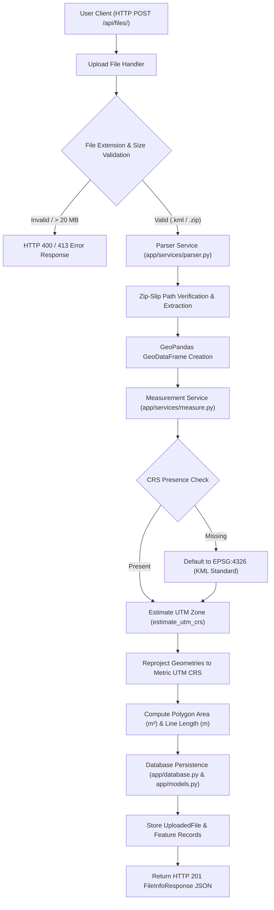

# geo-measure-api

> A high-performance, resilient FastAPI backend that parses geospatial files (`.kml` and `.zip` Shapefile archives), projects vector geometries to local UTM metric systems, and returns exact surface area and linear length measurements.

---

## Features

- **Multi-Format Vector Support:** Upload `.kml` documents and zipped Shapefile (`.zip`) archives.
- **Dynamic UTM Metric Projection:** Automates Coordinate Reference System (CRS) reprojection via GeoPandas `estimate_utm_crs()` so measurements are computed in meters ($m$) and square meters ($m^2$) rather than invalid angular degrees.
- **Per-Feature Granular Analysis:** Computes individual area measurements for `Polygon`/`MultiPolygon` features and length/perimeter for `LineString`/`MultiLineString` features.
- **Zip-Slip Security Protection:** Sanitizes archive extraction paths to protect against directory traversal security exploits.
- **Fault-Tolerant Processing:** Gracefully flags unsupported geometries (such as `Point` features or empty geometries) without failing the request.
- **SQLite Persistence with SQLAlchemy:** Stores upload file metadata and extracted feature records with full relational integrity and cascade deletion.
- **Interactive Documentation:** Built-in OpenAPI Swagger UI and ReDoc interfaces.

---

## Quick Start

### Local Setup

#### 1. Prerequisites & Environment Setup
Ensure Python 3.11+ is installed.

```bash
# Clone repository and navigate to directory
cd geo-measure-api

# Create and activate a virtual environment
python -m venv venv

# On Windows:
venv\Scripts\activate
# On Linux/macOS:
source venv/bin/activate

# Install dependencies
pip install -r requirements.txt
```

#### 2. Run Test Suite
```bash
pytest
```

#### 3. Start API Server
```bash
uvicorn app.main:app --reload --host 127.0.0.1 --port 8000
```
Access the interactive Swagger documentation at [http://127.0.0.1:8000/docs](http://127.0.0.1:8000/docs).

---

### Docker Deployment

#### 1. Build Docker Image
```bash
docker build -t geo-measure-api .
```

#### 2. Run Container
```bash
docker run -d --name geo-measure-app -p 8000:8000 geo-measure-api
```
Verify the container health endpoint at [http://localhost:8000/health](http://localhost:8000/health).

---

## Architecture & Data Flow



---

## API Documentation & Usage

### 1. Upload Geospatial File
- **Endpoint:** `POST /api/files/`
- **Content-Type:** `multipart/form-data`
- **Payload:** File field named `file` (`.kml` or `.zip`)

#### Example Request:
```bash
curl -X POST "http://127.0.0.1:8000/api/files/" \
  -H "accept: application/json" \
  -H "Content-Type: multipart/form-data" \
  -F "file=@tests/data/sample.kml"
```

#### Sample Response (`HTTP 201 Created`):
```json
{
  "id": "e4b9c102-6b3a-4422-b519-715cd5267b14",
  "filename": "sample.kml",
  "feature_count": 3,
  "crs": "EPSG:4326",
  "status": "COMPLETED",
  "error_message": null,
  "created_at": "2026-10-07T19:50:00Z"
}
```

---

### 2. Get File Info
- **Endpoint:** `GET /api/files/{id}/`

#### Example Request:
```bash
curl -X GET "http://127.0.0.1:8000/api/files/e4b9c102-6b3a-4422-b519-715cd5267b14/"
```

#### Sample Response (`HTTP 200 OK`):
```json
{
  "id": "e4b9c102-6b3a-4422-b519-715cd5267b14",
  "filename": "sample.kml",
  "feature_count": 3,
  "crs": "EPSG:4326",
  "status": "COMPLETED",
  "error_message": null,
  "created_at": "2026-10-07T19:50:00Z"
}
```

---

### 3. Get Feature Measurements
- **Endpoint:** `GET /api/files/{id}/measurements/`

#### Example Request:
```bash
curl -X GET "http://127.0.0.1:8000/api/files/e4b9c102-6b3a-4422-b519-715cd5267b14/measurements/"
```

#### Sample Response (`HTTP 200 OK`):
```json
{
  "file": {
    "id": "e4b9c102-6b3a-4422-b519-715cd5267b14",
    "filename": "sample.kml",
    "feature_count": 3,
    "crs": "EPSG:4326",
    "status": "COMPLETED"
  },
  "features": [
    {
      "id": 1,
      "file_id": "e4b9c102-6b3a-4422-b519-715cd5267b14",
      "feature_index": 0,
      "geometry_type": "Polygon",
      "geometry": {
        "type": "Polygon",
        "coordinates": [[[77.59, 12.97], [77.599218, 12.97], [77.599218, 12.978983], [77.59, 12.978983], [77.59, 12.97]]]
      },
      "properties": { "name": "1km Square Polygon" },
      "measurement_type": "area",
      "measurement_value": 995059.31,
      "unit": "square_meters",
      "crs_used": "EPSG:32643",
      "note": null
    },
    {
      "id": 2,
      "file_id": "e4b9c102-6b3a-4422-b519-715cd5267b14",
      "feature_index": 1,
      "geometry_type": "LineString",
      "geometry": {
        "type": "LineString",
        "coordinates": [[77.59, 12.97], [77.599218, 12.97]]
      },
      "properties": { "name": "1km Line" },
      "measurement_type": "length",
      "measurement_value": 1000.71,
      "unit": "meters",
      "crs_used": "EPSG:32643",
      "note": null
    },
    {
      "id": 3,
      "file_id": "e4b9c102-6b3a-4422-b519-715cd5267b14",
      "feature_index": 2,
      "geometry_type": "Point",
      "geometry": { "type": "Point", "coordinates": [77.59, 12.97] },
      "properties": { "name": "Landmark Point" },
      "measurement_type": null,
      "measurement_value": null,
      "unit": null,
      "crs_used": null,
      "note": "Point geometry has no area or length measurement."
    }
  ]
}
```

---

## Coordinate Reference System (CRS) Handling Explained

Vector datasets are often stored using geographic coordinate reference systems like WGS 84 (`EPSG:4326`), where points are expressed in angular degrees ($\text{latitude}, \text{longitude}$). 

Calculating distance or surface area directly on degree coordinates yields incorrect metrics (e.g. "square degrees"). To ensure real-world metric accuracy:

1. **CRS Detection & Fallback:** If an uploaded `.kml` file lacks explicit CRS headers, the API automatically assumes standard WGS 84 (`EPSG:4326`).
2. **Dynamic UTM Reprojection:** The measurement engine calculates the centroid of the feature dataset and estimates its local Universal Transverse Mercator (UTM) zone using `gdf.estimate_utm_crs()`.
3. **Metric Calculation:** Geometries are reprojected into the estimated UTM grid (e.g., `EPSG:32643` for UTM Zone 43N), where coordinates are represented in Euclidean meters ($m$). Surface areas are computed in square meters ($m^2$) and lengths in linear meters ($m$).

---

## Design Decisions Table

| Decision | Why Chosen | Alternative Considered & Reason Rejected |
| :--- | :--- | :--- |
| **Auto UTM (`estimate_utm_crs()`) vs. Fixed Global Projection** | Automatically selects the localized 2D UTM zone containing the geometries, minimizing scale distortion for area and length calculations. | **Fixed EPSG:3857 (Web Mercator):** Severe distance and area distortion near polar and non-equatorial latitudes. |
| **Synchronous HTTP Request vs. Async Background Queue** | Keeps setup simple, immediate, and straightforward for single files under 20 MB, allowing instant HTTP responses without external service dependencies. | **Celery / Redis / RabbitMQ Worker Queue:** Adds operational overhead (broker setup, worker management) which is unnecessary for lightweight processing. |
| **GeoPandas & pyogrio vs. Raw Shapely / PyProj** | `GeoPandas` + `pyogrio` simplifies vector file parsing, spatial indexing, attribute table handling, and UTM estimation into clean vectorized calls. | **Raw Shapely & Fiona:** Requires manually parsing OGR driver layers, writing custom attribute loop parsers, and managing low-level C bindings. |

---

## Known Limitations

- **Cross-UTM Zone Geometries:** Geometries spanning multiple UTM zones or continents (e.g., cross-country pipelines) are projected into a single estimated UTM zone, which may introduce minor scale distortion along boundary extremes.
- **Synchronous Upload Payload Limit:** Files are capped at **20 MB** to maintain low latency and prevent memory exhaustion on single-threaded workers.
- **Single Geometry Type Per Shapefile Layer:** Standard ESRI Shapefile rules apply when unpacking `.zip` archives (features within a single `.shp` file must share a geometry type).

---

## Key Learnings

- **Zip-Slip Vulnerability Prevention:** Unpacking archives requires validating that member destination paths remain inside the target directory using `target_path.relative_to(temp_dir)` before extracting file streams to disk.
- **Isolated Pytest Databases with `StaticPool`:** In-memory SQLite (`sqlite:///:memory:`) creates a separate database per connection. Using SQLAlchemy's `StaticPool` ensures all test connections share a single in-memory database instance.
- **Decoupled Architecture:** Separating file parsing (`app/services/parser.py`), spatial calculations (`app/services/measure.py`), ORM models (`app/models.py`), and FastAPI routes (`app/main.py`) improves modularity and testability.

---

## Future Scope

1. **Asynchronous Background Workers (Celery + Redis):** Offload large geospatial processing tasks to asynchronous task queues with webhooks and status polling.
2. **PostGIS / PostgreSQL Database Integration:** Migrate from SQLite to PostgreSQL with PostGIS for spatial SQL indexing and native spatial queries.
3. **Expanded Geospatial Support:** Support GeoJSON, GeoPackage (`.gpkg`), and raster dataset analysis (GeoTIFF zonal statistics).
4. **Authentication & Authorization:** Integrate JWT (JSON Web Tokens) or API Keys for secure client access control.
5. **Pagination & Filtering:** Add `limit` and `offset` parameters to `GET /api/files/{id}/measurements/` for high-feature datasets.
